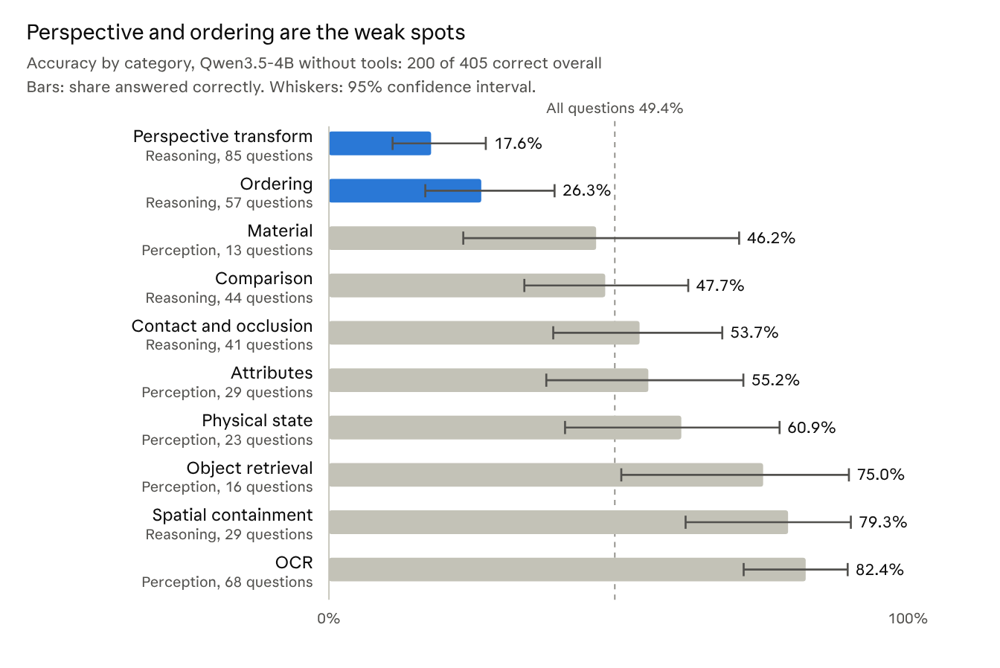
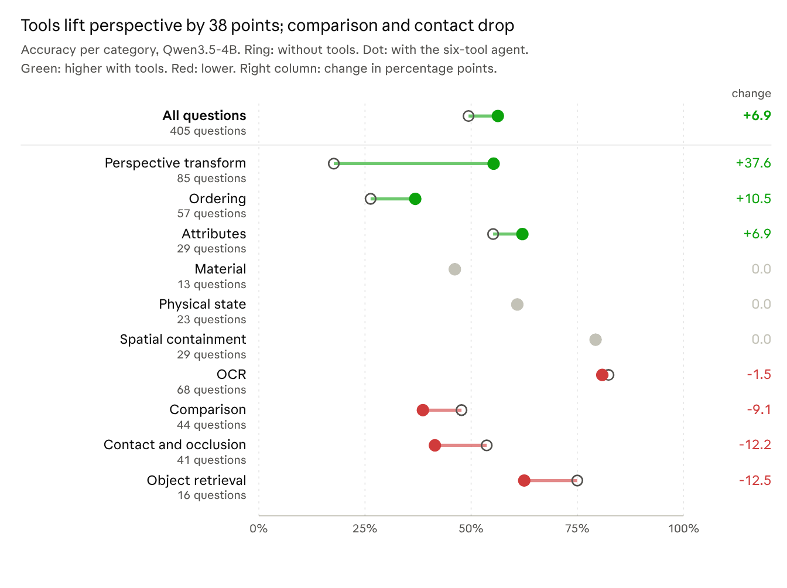

# Qwen3.5-4B on TreeBench: setup and results

As of 2026-11-26. Baseline and tool-agent runs complete (405 questions each).

Qwen3.5-4B answers **200 of TreeBench's 405 questions correctly (49.4%, 95% CI 44.5–54.2%)** with thinking on and no tools. Perception questions reach 69.8%; reasoning questions only 37.5%, pulled down by perspective transform (17.6%, below the 25% chance rate) and ordering (26.3%).

The main failure is not missing knowledge. On perspective questions the model judges front and back correctly 69% of the time but left and right only 22%: it answers from the camera's side instead of the person's.

With six tools and a step-by-step procedure for perspective questions, the same model reaches **228 of 405 (56.3%), 6.9 points above the baseline** (77 questions fixed, 49 broken; McNemar p = 0.016). Perspective transform rises from 17.6% to 55.3%; comparison and contact-and-occlusion drop by 9 and 12 points.

## Setup

### Data: TreeBench

[TreeBench](https://arxiv.org/abs/2507.07999) (Hugging Face `HaochenWang/TreeBench`) has 405 multiple-choice questions on dense, high-resolution SA-1B photos of about 2–7 megapixels. They fall into 10 categories: 149 Perception questions (attributes, material, OCR, object retrieval, physical state) and 256 Reasoning questions (comparison, contact and occlusion, ordering, perspective transform, spatial containment).

- Answers and target-object boxes are public, so answers are graded locally: the first option letter in the reply must match. No LLM judge.
- For the 68 OCR questions, the question and options are printed on the image; the text prompt only asks the model to read and answer them.
- All 405 questions were used. No question was held out or tuned on for the baseline.

### Model: Qwen3.5-4B

Qwen3.5-4B is Qwen's open-weight 4-billion-parameter vision-language model (February 2026), run with thinking mode on.

- Language model: 32 layers, hybrid attention (24 linear-attention, 8 full-attention layers), 262,144-token context.
- Vision: 16-pixel patches merged 2×2, so one image token covers 32×32 pixels. Images up to 16.8 megapixels go in at full resolution, so TreeBench photos are never shrunk: they cost about 2,200–6,800 image tokens (median input 3,375 tokens).

### Training: none

Everything here is zero-shot inference with the released weights: no fine-tuning, no reinforcement learning, no in-context examples. The tool agent is training-free too; only its prompt changes.

### Inference parameters (baseline)

| Setting | Value |
| --- | --- |
| Serving | vLLM 0.32.0, float16, one Quadro RTX 8000 (48 GB) per job |
| Thinking | On (`enable_thinking: true`); the thinking text is saved separately (`--reasoning-parser qwen3`) |
| Sampling | temperature 1.0, top_p 0.95, top_k 20, min_p 0, presence_penalty 1.5, repetition_penalty 1.0, seed 0 (Qwen's recommended thinking-mode settings) |
| Max output tokens | 25,000 per answer (thinking + reply) |
| Context length | 32,768 tokens |
| Prompt | One user turn: the image, the question, the options, then "Answer with the option's letter from the given choices directly." No system prompt. |
| Requests | 32 at a time; client timeout 600 s, up to 5 retries |
| Compute | Two GPUs, about 8 GPU-hours for 405 questions |

## Baseline results

The baseline answered all 405 questions; 28 of them ended without a usable answer and count as wrong.

| Questions | n | Accuracy (95% CI) | Correct | Wrong | Timed out | Aborted | Median output tokens (right / wrong) |
| --- | --- | --- | --- | --- | --- | --- | --- |
| All | 405 | **49.4%** (44.5–54.2) | 200 | 177 | 19 | 9 | 1,459 / 2,600 |
| Perception | 149 | 69.8% (62.0–76.6) | 104 | 43 | 0 | 2 | |
| Reasoning | 256 | 37.5% (31.8–43.6) | 96 | 134 | 19 | 7 | |

- **Timed out:** 19 answers whose thinking ran past the client's 600-second limit on all 6 attempts; 14 of them are ordering questions. No answer reached the 25,000-token limit (the longest used 10,686).
- **Aborted:** 9 requests the server dropped mid-answer, with no letter.
- On the 377 questions it finished, accuracy is 53.1%. Median time per answer was 219 s.

For context, the TreeBench paper reports o3 at 54.8%, GPT-4o at 46.9%, Qwen2.5-VL-72B at 42.2% and Qwen2.5-VL-7B at 37.0%, with its own prompt and harness ([paper](https://arxiv.org/abs/2507.07999)).

## Accuracy by category

| Category | Group | n | Correct | Accuracy (95% CI) | Timed out |
| --- | --- | --- | --- | --- | --- |
| Perspective transform | Reasoning | 85 | 15 | 17.6% (11.0–27.1) | 3 |
| Ordering | Reasoning | 57 | 15 | 26.3% (16.6–39.0) | 14 |
| Material | Perception | 13 | 6 | 46.2% (23.2–70.9) | 0 |
| Comparison | Reasoning | 44 | 21 | 47.7% (33.8–62.1) | 0 |
| Contact and occlusion | Reasoning | 41 | 22 | 53.7% (38.7–67.9) | 2 |
| Attributes | Perception | 29 | 16 | 55.2% (37.5–71.6) | 0 |
| Physical state | Perception | 23 | 14 | 60.9% (40.8–77.8) | 0 |
| Object retrieval | Perception | 16 | 12 | 75.0% (50.5–89.8) | 0 |
| Spatial containment | Reasoning | 29 | 23 | 79.3% (61.6–90.2) | 0 |
| OCR | Perception | 68 | 56 | 82.4% (71.6–89.6) | 0 |

The two reasoning categories that need a change of viewpoint or a complete count sit far below the rest; reading text (OCR) and judging whether one thing is inside another are close to solved. Material, object retrieval and physical state have under 25 questions each, so their wide intervals overlap the overall rate.

## Why the model fails

Most errors come from two reasoning mistakes, not from missing knowledge. Only a few material questions look like real knowledge gaps (for example, brass versus lacquered wood).

### Perspective: left and right are mirrored

On the 73 perspective questions with four-direction options (front left, front right, left rear, right rear), each answer was scored on its two parts separately.

| Part of the answer | Right | Rate | Chance |
| --- | --- | --- | --- |
| Front or back | 50 / 73 | 68.5% | 50% |
| Left or right | 16 / 73 | 21.9% | 50% |
| Whole answer | 13 / 73 | 17.8% | 25% |
| Whole answer if every left/right were mirrored | 37 / 73 | 50.7% | |

The thinking text shows why: the model mentions which way the person faces, then reads left and right as the camera sees them. It finds the people correctly: in 27 of the 37 wrong answers where it wrote coordinates, its boxes matched both target objects (IoU at least 0.3).

### Ordering: objects are missed

For "the third one from the left" or "the second closest", the reasoning over the list is sound, but the list is short: it counts 3 people where there are 4, or 2 streetlights where there are 3. On top of that, 14 of the 57 ordering questions timed out, so 26.3% understates the questions it actually answered (34.9%).

### Thinking length

Wrong answers think longer: a median of 2,600 output tokens against 1,459 for right ones. Perspective questions are the exception: the few right answers think longer (3,922 against 2,525 thinking tokens), which fits working through the person's point of view instead of the camera's.

## Tool agent: 56.3%, up 6.9 points

The same model, weights and sampling get six tools that it calls one at a time before answering. On all 405 questions it scores 228 (56.3%), against 200 for the baseline; the gain comes almost entirely from perspective questions. The run finished on 2026-11-26 on two Quadro GPUs.

| Tool | What it does | Network |
| --- | --- | --- |
| zoom | Crops a region of the original image and enlarges small crops up to 3× | none |
| detect | Finds every instance of a named object; boxes plus a numbered image | Grounding DINO (tiny) |
| depth | Ranks objects from nearest to farthest from the camera | Depth Anything V2 (Small) |
| distance | Ranks objects by 3D distance from a reference object | Depth Anything V2 (Small) |
| orient | Which way a person faces, from body keypoints, as an angle | ViTPose (base) |
| viewpoint | Where targets are from a reference's own point of view, given its facing; a top-down map | Depth Anything V2 (Small) |

What changes from the baseline:

- **Prompt:** Qwen's chat template lists the six tools in the system prompt, followed by the agent's instructions (version `tb3`). Perspective questions get three steps: find both objects, run orient and check it against the keypoint image, then run viewpoint with that facing.
- **Tool calls:** in Qwen3.5's own format, parsed by vLLM (`qwen3_coder`). One call per reply, up to 20 per question.
- **Limits:** 32,768 output tokens per turn, 131,072-token context, 3,600-second timeout. The thinking of every turn is saved.

### Results

| | Baseline | Agent |
| --- | --- | --- |
| Correct | 200 / 405 (49.4%) | **228 / 405 (56.3%)** |
| 95% CI | 44.5–54.2% | 51.4–61.0% |
| Question by question | | 77 fixed, 49 broken (McNemar p = 0.016) |
| No answer (timed out or aborted) | 28 | 0 |
| Median output tokens per question | 2,087 | 3,380 |
| Median time per question | 219 s | 294 s |
| GPU time | about 8 hours | about 3 hours |

| Category | n | Baseline | Agent | Change (points) | Fixed / broken |
| --- | --- | --- | --- | --- | --- |
| Perspective transform | 85 | 17.6% | **55.3%** | +37.6 | 39 / 7 |
| Ordering | 57 | 26.3% | 36.8% | +10.5 | 15 / 9 |
| Attributes | 29 | 55.2% | 62.1% | +6.9 | 4 / 2 |
| Material | 13 | 46.2% | 46.2% | 0 | 1 / 1 |
| Physical state | 23 | 60.9% | 60.9% | 0 | 2 / 2 |
| Spatial containment | 29 | 79.3% | 79.3% | 0 | 2 / 2 |
| OCR | 68 | 82.4% | 80.9% | −1.5 | 5 / 6 |
| Comparison | 44 | 47.7% | 38.6% | −9.1 | 5 / 9 |
| Contact and occlusion | 41 | 53.7% | 41.5% | −12.2 | 3 / 8 |
| Object retrieval | 16 | 75.0% | 62.5% | −12.5 | 1 / 3 |

### How it used the tools

- 2.1 calls per question on average, at most 14, never near the 20-call cap. 94 questions were answered without a tool (52% right), the other 311 with tools (58% right).
- Calls: zoom 409, detect 217, orient 105, viewpoint 81, depth 11, distance 7. Of 842 calls, 36 failed: orient 14 (no shoulders found), a made-up "answer" tool 11 (recovered), viewpoint 7, zoom 4.
- On perspective questions, viewpoint ran on 62 of 85; 40 of those were right (65%), against 7 of the 23 where it was skipped (30%).

### Where it helps and where it hurts

- **Perspective (+37.6 points):** orient then viewpoint fixes the mirrored left and right: 39 questions fixed, 7 broken.
- **Ordering (+10.5):** nothing timed out this time, and detect's numbered boxes help counting; it still misses objects (9 broken).
- **Comparison (−9.1) and contact and occlusion (−12.2):** 7 of the 9 newly wrong comparison answers followed a detect call, and 7 of the 8 newly wrong contact answers followed a zoom. A cropped or boxed view seems to lose the context these questions need; these traces are the next thing to read.

A 5-question smoke test before the full run found two small problems, both fixed before it: the model sometimes called a made-up "answer" tool, and once put the facing argument in the wrong place.

## Reproduce

Everything is in this repository on branch `treebench-small-qwen-notools`.

| What | Where |
| --- | --- |
| Baseline config | `configs/treebench_local/qwen3.5-4b-think-fp16.yaml` |
| Baseline job (vLLM + run) | `slurm/treebench_qwen35_4b.sh` |
| Agent config and job | `configs/treebench_local/qwen3.5-4b-agent-tb3.yaml`, `slurm/treebench_qwen35_4b_agent.sh` |
| Exact agent prompt | `reports/qwen35_4b_agent_tb3_prompt.txt` |
| Baseline answers, with thinking (Git LFS) | `runs/treebench__vllm__Qwen_Qwen3.5-4B__default__think-fp16` and `…-part2` |
| Agent answers, with every step's thinking and tool calls (Git LFS) | `runs/treebench__vllm__Qwen_Qwen3.5-4B__default__agent-tools-tb3-native-sys__think-fp16` and `…-part2` |
| Failure analysis | `analysis/treebench_failures.py` |

Run the baseline with `sbatch --nodelist=quadro2 slurm/treebench_qwen35_4b.sh` and the agent with `sbatch slurm/treebench_qwen35_4b_agent.sh`; a re-run skips questions already answered. The failure analysis is `python analysis/treebench_failures.py --out <dir> <run folders>`. The trace portal, kept locally and not in the repository (`python portal/serve.py`), shows every answer with its thinking and, for agent runs, each tool step.
